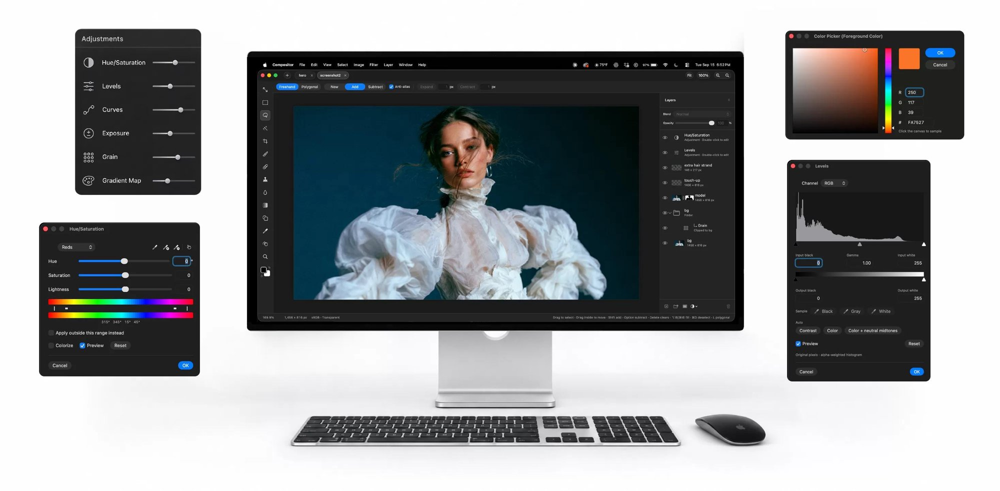

# AIPDD PhotoEditor（base Compositor）

[English](README.md) · [简体中文](README.zh-Hans.md) · [Français](README.fr.md) · [日本語](README.ja.md) · [العربية](README.ar.md) · **Tiếng Việt** · [Español](README.es.md) · [Русский](README.ru.md)



Adobe Photoshop quá đắt, còn những công cụ như GIMP lại không đủ quen thuộc để tôi duy trì dòng chảy sáng tạo. Vì vậy tôi tạo ra Compositor.

Mục tiêu là tạo ra một trình chỉnh sửa ảnh đầy đủ tính năng, hoàn toàn miễn phí và mã nguồn mở. Trước đây tôi dùng Photoshop để ghép ảnh và hậu kỳ, nên Compositor được xây quanh quy trình đó — với các công cụ cần thiết để tạo một bức ảnh cuối cùng chuẩn đến từng điểm ảnh.

Vì mã nguồn mở, bạn có thể tải dự án Xcode về và thêm, xóa hoặc sửa bất cứ tính năng nào cho vừa với quy trình của mình.

## Cài đặt

### Tải về
Tải Compositor từ [robbietilton.com/compositor](https://robbietilton.com/compositor), hoặc tải bản phát hành mới nhất trực tiếp từ [GitHub Releases](https://github.com/robbietilton/Compositor/releases/latest).

### Homebrew

```sh
brew install --cask robbietilton-compositor
```

## Tính năng

### Lớp
- Các lớp và thư mục, với độ mờ và toàn bộ chế độ hòa trộn của Photoshop theo đúng thứ tự — độ mờ của thư mục làm tối mọi thứ bên trong
- Mặt nạ lớp: vẽ, tô, đảo ngược, làm mờ và làm mềm ở bất kỳ đâu trên canvas, kể cả vượt ra ngoài điểm ảnh của lớp; liên kết hoặc hủy liên kết để biến đổi mặt nạ riêng
- Mặt nạ cắt và mặt nạ thư mục
- Lớp điều chỉnh: Hue/Saturation, Levels, Curves, Phơi sáng, Gradient Map, Hạt, Đen Trắng, Cân bằng màu, Đảo ngược, Làm mờ Gaussian, Làm mờ Chuyển động và Nhiễu
- Hiệu ứng lớp: Viền, Đổ bóng, Ô phủ màu, Đổ bóng trong, Phát sáng ngoài và Phát sáng trong, kết xuất trên GPU và chỉnh sửa bất cứ lúc nào
- Gộp xuống, Gộp các lớp và Gộp nhóm (⌘E)
- Nhân bản, đổi tên nội tuyến, sắp xếp và lồng bằng kéo-thả; Option-kéo để nhân bản; menu chuột phải trong bảng Lớp
- Sao và dán cả lớp và thư mục (⌘C/⌘V khi không có lựa chọn), trong cùng dự án hoặc giữa các dự án, hoặc kéo chúng giữa các dự án

### Biến đổi
- Di chuyển, co giãn, xoay và lật không phá hủy — ảnh giữ nguyên độ phân giải dù bạn thu nhỏ bao nhiêu
- Làm méo tự do (⌘-kéo một điểm), Shift để khóa theo trục
- Biến đổi nhiều lớp, hoặc cả thư mục, cùng nhau
- Căn snapped vào cạnh và tâm canvas và lớp, kèm đường gióng
- Giá trị chính xác cho vị trí, kích thước, tỷ lệ và góc, tinh chỉnh bằng phím mũi tên
- Lật lớp và Lật canvas, ngang và dọc

### Vùng chọn
- Chọn hình chữ nhật và ellipse, thòng lọng tự do và thòng lọng đa giác, và công cụ thông minh — Magic Wand chọn theo màu, Object vẽ whatever bạn click (Tab để đổi)
- Chọn chủ thể, và Mở rộng, Thu nhỏ và Làm mềm cho bất kỳ lựa chọn nào
- Thêm vào và trừ đi các lựa chọn, di chuyển viền, hoặc di chuyển và nhân đôi điểm ảnh bên trong
- Tải điểm ảnh của lớp hoặc mặt nạ thành lựa chọn
- Content-Aware Fill, cũng có thể kéo ảnh vượt ra ngoài cạnh

### Vẽ và tẩy retouch
- Cọ với kích thước, độ cứng, độ mờ và làm mượt, ở chế độ Vẽ hoặc Tẩy (B và E), Shift cho đường thẳng
- Spot Healing Brush (content-aware)
- Clone Stamp, có căn chỉnh hoặc không, lấy mẫu từ một lớp hoặc tất cả
- Công cụ làm mờ, trên điểm ảnh hoặc mặt nạ
- Công cụ Gradient và Công cụ Hình (chữ nhật, chữ nhật bo tròn, ellipse và đường thẳng), giữ nguyên khả năng chỉnh sửa thay vì raster hóa
- Công cụ Chữ (T): chỉnh sửa đa dòng nội tuyến trong hộp đoạn văn có thể kéo và đổi kích; phông, cỡ, màu, canh và khoảng cách nằm ở đầu công cụ; biến đổi chữ và dùng nó làm mặt nạ cắt
- Nhỏ giọt và hộp màu đầy đủ

### Điều chỉnh và bộ lọc
- Bộ lọc Camera Raw: ánh sáng, màu, đường cong, trộn màu, chỉnh màu, chi tiết, quang học và hình học, trong một bảng bên cạnh canvas; mỗi mục reset về mặc định từ tiêu đề của nó
- Levels (kèm Auto), Curves, Hue/Saturation, Phơi sáng, Gradient Map, Hạt, Đen Trắng, Cân bằng màu và Đảo ngược
- Làm mờ Gaussian và Làm mờ Chuyển động lan vượt ra cạnh của lớp
- Thêm Nhiễu, Tối góc, Bloom / Glow, Dither, Scanlines, Tương phản tông, Sửa ống kính và Xóa nền
- Xem trước trực tiếp, giới hạn vào lựa chọn nếu có
- Bộ lọc cuối (⌃⌘F) chạy lại bộ lọc cuối với cùng thiết lập

### Canvas và tệp
- Nhiều dự án trong các tab
- Tìm lệnh (⌘F): tìm mọi lệnh menu và công cụ theo tên, như trong Raycast hoặc Obsidian, và chạy với Enter
- Chuyển toàn màn hình (F): chỉ canvas trên nền đen phủ toàn màn hình, mọi bảng thu lại; F hoặc Esc trả lại
- Thước (⌘R), đường gióng kéo từ thước, lưới bố cục với khoảng cách và chia con có thể chỉnh, và Snap To cho đường gióng, lưới, lớp và biên tài liệu
- Cắt với snapped, các tỷ lệ gồm 3:4 và 9:16, và Option để cắt đối xứng; nếu có lựa chọn, việc cắt bắt đầu từ đó
- Kích thước canvas, Kích thước ảnh và Cắt bỏ
- Bản đồ Navigator ở góc canvas khi zoom dưới 300%: toàn bộ tài liệu thu nhỏ với một khung quanh vùng nhìn; nhấp hoặc kéo để nhảy tới (Xem › Navigator)
- Lấy mẫu xuống sắc nét, chất lượng cao khi phóng out, và lưới điểm ảnh khi phóng in
- Nhập JPEG, PNG, HEIC, TIFF, WebP, SVG, RAW máy ảnh (kèm một bước phát triển), và PSD/PSB của Photoshop (RGB 8-bit; không CMYK). Thư mục, mặt nạ, chế độ hòa trộn, hình chữ nhật/ellipse tô, và chữ ngang đơn giản của Photoshop giữ nguyên khả năng chỉnh sửa; các vector khác và chữ dọc trở thành điểm ảnh. Báo cáo chuyển đổi được hiển thị trước khi áp dụng bất cứ gì
- Tài liệu lớn: ngân sách bộ nhớ tăng theo Mac của bạn, và một tệp Photoshop quá lớn để mở sẽ bị cắt lớp về theo canvas
- Xuất PNG (⇧⌘E), Xuất JPEG (⇧⌥⌘S) và Xuất dưới dạng (⇧⌥⌘W) cho PNG, JPEG hoặc PDF một trang ở cỡ in, co giãn nếu muốn, kèm xem trước trực tiếp, chất lượng JPEG và kích thước tệp; Sao chép đã gộp
- Tiếp tục làm việc trong khi dự án đang lưu
- Phím tắt kiểu Photoshop khắp nơi, đổi được trong Chỉnh sửa › Phím tắt bàn phím
- Kéo nhãn của một con số để scrub giá trị, như trong Photoshop
- Tự động cập nhật, có chữ ký và công chứng

### AI (tự mang gateway)
- AI Gateway (⌘,) trỏ mọi tính năng AI tới bất kỳ máy chủ tương thích OpenAI nào bạn tin dùng — hosted, proxy công ty, hoặc runner cục bộ. Kênh có độ ưu tiên, trọng số, thời gian chờ, proxy HTTP/HTTPS/SOCKS tùy chọn, và override theo năng lực cho mô hình, đường dẫn và kênh; API key nằm trong macOS Keychain, không bao giờ trong tệp cấu hình. Kênh AIPDD dựng sẵn để bạn bắt đầu chỉ với một key. Kiểm tra Kết nối xác minh một kênh trước khi lưu
- Các năng lực là slots, không phải endpoint cứng: Text Chat, Image Generation, Image Editing, Video, Text-to-Speech, Speech-to-Text, Embeddings và Decision Model mỗi cái tự chọn kênh và mô hình, để bạn có thể, ví dụ, chuyển tác vụ hình ảnh cho một nhà cung cấp và chat cho nhà cung cấp khác
- Mỗi hành động AI là một lệnh menu, nên nó hiện trong Tìm lệnh (⌘F) và đổi được trong Chỉnh sửa › Phím tắt bàn phím
- Tạo ảnh: text-to-image với kích thước, chất lượng, phong cách, số lượng và prompt phủ định; kéo kết quả lên canvas thành các lớp mới, hoặc lưu ra đĩa
- Chỉnh sửa ảnh và Vẽ lại vùng (image-to-image): gửi điểm ảnh của lớp đang hoạt động cho gateway kèm prompt, và hoặc thay lớp ngay tại chỗ (undo được, giữ mặt nạ) hoặc thêm kết quả làm lớp mới; khi lớp đang hoạt động có mặt nạ bật, mặt nạ đó cũng được gửi, để mô hình chỉ chỉnh sửa phần bạn đánh dấu
- Chuyển phong cách: đưa gateway một ảnh tham chiếu và cường độ (0–100%), ghép tông của nó vào lớp đang hoạt động
- Chỉnh sửa ngôn ngữ tự nhiên: mô tả chỉnh sửa bằng lời thông thường — "tăng độ bão hòa", "đổi tên thành sky", "bỏ chọn chủ thể", "nhóm các lớp này" — mô hình chat trả về ý định có cấu trúc, trình chỉnh sửa thực hiện qua cùng code path như bấm menu, kèm parser từ khóa làm fallback khi offline. Ý định phá hủy (xóa, thay điểm ảnh) yêu cầu xác nhận trước khi làm
- Chọn theo ngữ nghĩa: pipeline mặt nạ → canvas đã nối — một mask phân đoạn từ gateway trở thành hoặc mặt nạ lớp (trắng lộ ra), hoặc lựa chọn march-ants được trace dọc biên chính xác của điểm ảnh, đặt dưới biến đổi của lớp. Mô hình text-to-mask vẫn là chỗ để trống; endpoint đã sẵn cho dịch vụ tương thích SAM
- Video, Giọng nói và Chép lời chạy qua hàng đợi tác vụ bất đồng bộ: gửi → poll với backoff lũy thừa → tải về. Poll có hạn định và tôn trọng hủy, nên gateway kẹt không thể làm bảng điều khiển đứng; một nút Hủy thả tác vụ ngay tại chỗ
- Không có gì rời khỏi Mac của bạn trừ khi tới kênh bạn đã cấu hình; ứng dụng không gọi về nhà, không kèm theo API key, và không đo lường sử dụng

### Hoạt động với AI agent
- Agent AI và script có thể trực tiếp tạo và sửa dự án: `.comp` là một thư mục gồm các lớp PNG và một manifest, và dự án đang mở sẽ cập nhật trực tiếp khi được ghi. Xem [Viết dự án Compositor](docs/writing-comp-files.md)

## Yêu cầu

- macOS 26.0 trở lên trên Mac có Apple silicon
- Xcode 26 trở lên (để build từ mã nguồn)

## Dịch

Compositor có sẵn tám ngôn ngữ giao diện — Anh, Giản thể Trung, Pháp, Nhật, Ả Rập, Việt, Tây Ban Nha và Nga — và bạn có thể chọn một ngôn ngữ rõ ràng trong AI Gateway Settings › Chung (hoặc để Follow System để theo thứ tự ngôn ngữ trong System Settings). Giao diện phản ánh locale: tiếng Ả Rập chuyển sang bố cục phải-sang-trái ở lần khởi động tới.

Kho chuỗi nằm ở `Compositor/Resources/*.lproj/Localizable.strings`, mỗi locale một tệp, khóa chính là chuỗi tiếng Anh gốc. Khóa thiếu rơi về bản gốc tiếng Anh, nên dịch dở vẫn dùng được. Sẵn sàng chào đón các PR từ người bản ngữ để lấp khoảng trống hoặc cải thiện cách diễn đạt hiện có; nếu bạn nhận một locale lần đầu, bắt đầu từ các bề mặt hay thấy (menu, sheet AI, đầu công cụ) trước khi vào tooltip sâu hơn.

## Build

Mở `Compositor.xcodeproj` và chạy scheme **Compositor**.

## Phát hành

`scripts/release.sh` build bản Release, ký bằng Developer ID, notarize và staple, rồi gói thành `dist/Compositor-<version>.dmg`.

Cần những thứ sau, tất cả nằm ngoài repo này:

- chứng chỉ **Developer ID Application** trong login keychain
- thông tin notarization lưu bằng `xcrun notarytool store-credentials "compositor-notary" …`
- [`create-dmg`](https://github.com/create-dmg/create-dmg) (`brew install create-dmg`)

## Cộng đồng

Compositor được phát triển công khai, và cách nhanh nhất để định hình bước tiếp theo là tham gia thảo luận. Tôi giữ một nhóm nhỏ trên WeChat (ID: **raikkonenlxx**) cho người dùng và nhà phát triển trao đổi prompt, báo lỗi, chia sẻ tệp `.comp`, và nói về cấu hình gateway và tính năng AI — 想一起研究的朋友，加微信 **raikkonenlxx** 备注 Compositor. Kết bạn với ghi chú "Compositor" để tôi biết bạn không phải bot.

<div align="center">
  
</div>
<br>

Với những thứ cần lưu lại hồ sơ — lỗi tái hiện được, yêu cầu tính năng, PR — hãy mở trên GitHub để thảo luận dễ tìm.

## Giấy phép

MIT — xem [LICENSE](LICENSE).
